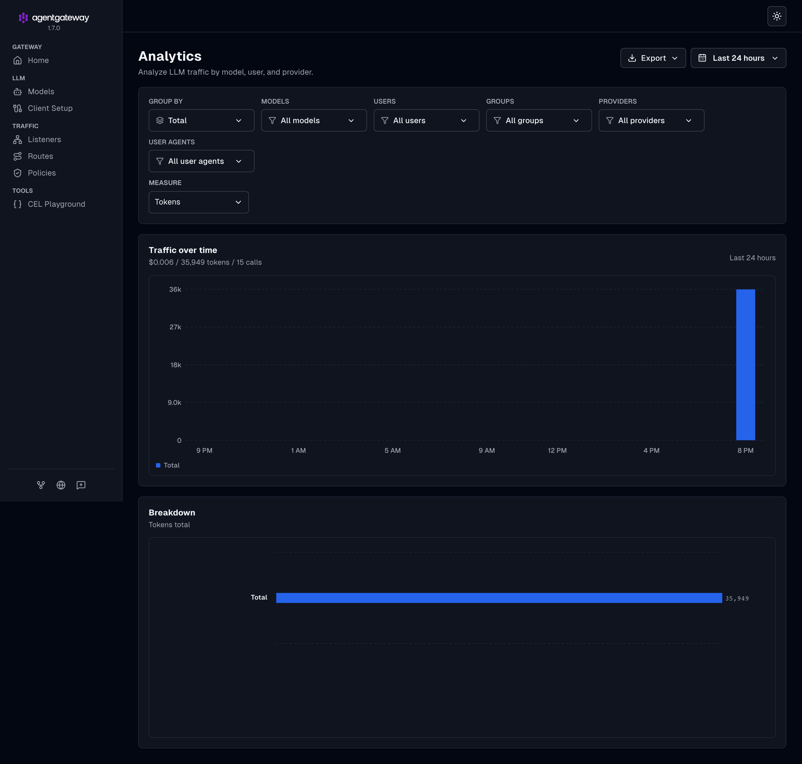
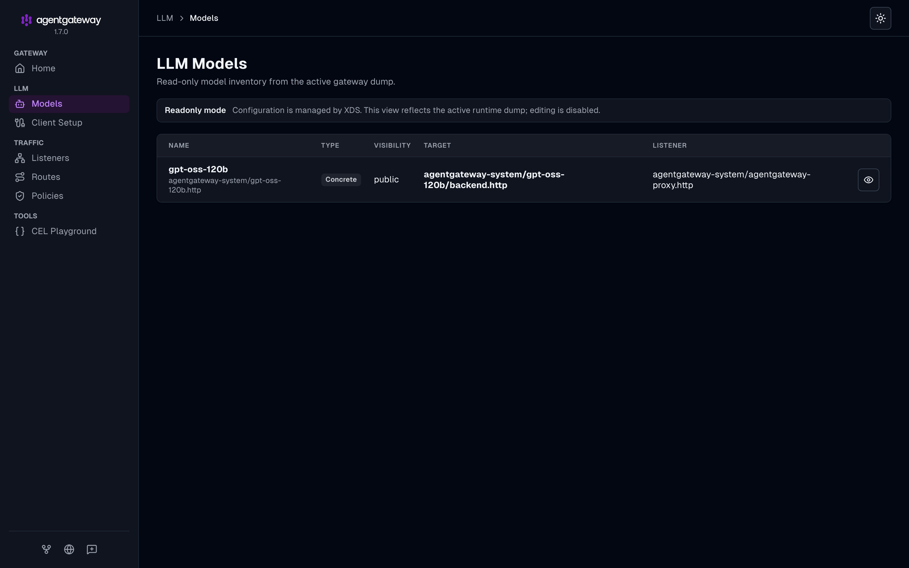
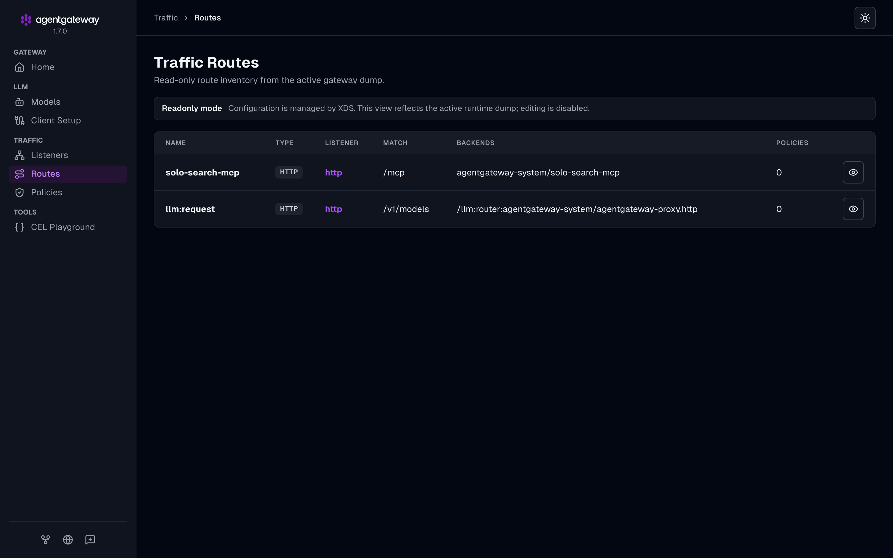
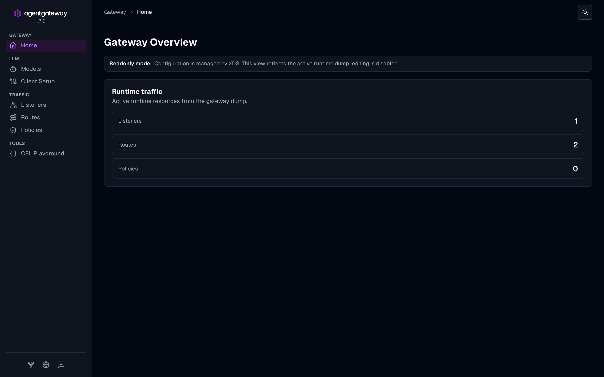

# Codex CLI and Claude Code through agentgateway on kind

Routes coding-agent traffic through [agentgateway](https://agentgateway.dev/docs/kubernetes/latest/) running in a local kind cluster. The gateway holds the Amazon Bedrock API key and publishes Bedrock models; the clients talk to the gateway with no key of their own.

| Client | Models (all on Amazon Bedrock) | Guide |
|---|---|---|
| OpenAI Codex CLI | `gpt-oss-120b`, `gpt-oss-20b`, `claude-haiku-4-5` | [codex/README.md](codex/README.md) |
| Claude Code | Claude Opus, Sonnet and Haiku 5.5 | [claude-code/README.md](claude-code/README.md) |

```
codex   (--profile agentgateway) ─┐
                                  ├─► localhost:8080 ──► agentgateway-proxy
claude  (claude-agw profile) ─────┘   (no API key)          │
                                                            ├─ /v1/*  ──► Amazon Bedrock us-east-2 (gateway adds the key)
                                                            ├─ /mcp   ──► https://search.solo.io/mcp
                                                            └─ logs   ──► Postgres ──► UI Logs / Analytics
```

This page builds the gateway. Each client guide then has two paths side by side: a script, and the same
thing by hand.

Optionally the gateway requires a Microsoft Entra ID sign-in and group membership
([Codex](entra-id/README.md), [Claude Code](claude-code/README.md#step-5--optional-entra-id-sign-in)).


Based on:

- LLM quickstart (models): <https://agentgateway.dev/docs/kubernetes/latest/quickstart/llm/>
- Bedrock provider: <https://agentgateway.dev/docs/kubernetes/latest/llm/providers/bedrock/>
- Install: <https://agentgateway.dev/docs/kubernetes/latest/quickstart/install/>
- OpenAI provider: <https://agentgateway.dev/docs/kubernetes/latest/llm/providers/openai/>
- Cost dashboard / request-log database: <https://agentgateway.dev/docs/kubernetes/latest/documentation/llm/cost-controls/dashboard/>
- Remote MCP over HTTPS: <https://agentgateway.dev/docs/kubernetes/latest/mcp/https/>
- Codex client: <https://agentgateway.dev/docs/kubernetes/latest/integrations/llm/clients/codex/>
- Claude Code client: <https://agentgateway.dev/docs/kubernetes/latest/integrations/llm/clients/claude-code/>

## Versions used

| Component | Version |
|---|---|
| kind | v0.30.0 (node image `kindest/node:v1.34.0`) |
| Gateway API CRDs | v1.6.3 (standard channel) |
| agentgateway (Helm) | v1.7.0 |
| Helm | v4.0.5 |
| Codex CLI | 0.170.0 |
| Claude Code | 2.1.328 |
| Docker Desktop | 28.5.1 (macOS, arm64) |

## What gets deployed

| Piece | How | Where |
|---|---|---|
| Gateway API CRDs v1.6.3 | `kubectl apply` | Step 3 |
| agentgateway CRDs + controller v1.7.0 | Helm (2 releases) | Step 4 |
| Postgres for request logs | manifest `k8s/03-postgres.yaml` | Step 5 |
| Proxy database settings | manifest `k8s/04-gateway-parameters.yaml` | Step 5 |
| Gateway → proxy Deployment + LoadBalancer | manifest `k8s/01-gateway.yaml` | Step 6 |
| Gateway on a fixed `localhost:8080` | `kind-config.yaml` + manifest `k8s/09-fixed-port.yaml` | Steps 1 and 6 |
| Model `gpt-oss-120b` (OpenAI on Bedrock) | manifest `k8s/02-model-bedrock-openai.yaml` | Step 7 |
| MCP server `search.solo.io` at `/mcp` | manifest `k8s/05-mcp-solo-search.yaml` | Step 10 |
| Codex profile | `~/.codex/agentgateway.config.toml` | [codex/README.md](codex/README.md) |
| *Optional:* models `gpt-oss-20b` and `claude-haiku-4-5` | manifest `k8s/07-more-bedrock-models.yaml` | Step 7 |
| *Optional:* models Claude Opus, Sonnet and Haiku 5.5 | manifest `k8s/08-claude-code-models.yaml` | Step 7 |
| Claude Code profile | `~/.claude-agentgateway` | [claude-code/README.md](claude-code/README.md) |
| *Optional:* Entra ID sign-in + group check | manifest `k8s/06-entra-auth.yaml` | [Optional — Entra ID sign-in](#optional--entra-id-sign-in) |

Secrets (`bedrock-secret`, `agentgateway-db`) are created from the command line and are not stored in
this directory.

## Prerequisites

- Docker Desktop running
- `kind`, `kubectl`, `helm`, `jq`, `openssl` on your `PATH`, plus `codex` and/or `claude`
- `BEDROCK_API_KEY` exported in your shell (Bedrock console → API keys)

Every `kubectl`/`helm` command below pins the context so nothing lands on another cluster by accident:

```sh
export CTX=kind-agentgateway-codex
```

## Option A — Build it with the script

One script runs Steps 1–8 and 10 below, with all models:

```sh
export BEDROCK_API_KEY='<your Bedrock API key>'
scripts/deploy.sh                       # gateway at http://localhost:8080
```

The script is safe to rerun. When it finishes, test the gateway (Step 9), open the UI (Step 11) and
[connect a client](#connect-a-client).

## Option B — Build it by hand

Steps 1–11 below do the same thing one command at a time and explain each piece.

## Step 1 — Create the kind cluster

[`kind-config.yaml`](kind-config.yaml) maps `localhost:8080` on your machine to port 30080 on the node,
which is where Step 6 publishes the gateway. The address is fixed and listens on `127.0.0.1` only.

```sh
kind create cluster --name agentgateway-codex --config kind-config.yaml
kubectl --context $CTX get nodes
```

> `kind create cluster` switches your current kubectl context to `kind-agentgateway-codex`.
> Switch back with `kubectl config use-context <name>` when you are done.

## Step 2 — Optional: cloud-provider-kind

Skip this step unless you want the gateway's `LoadBalancer` Service to get an external IP. With the
fixed port from Step 1 nothing else needs it.

<details>
<summary>Running cloud-provider-kind</summary>

Run it in a separate terminal and leave it running:

```sh
cloud-provider-kind --gateway-channel disabled --enable-lb-port-mapping
```

- `--gateway-channel disabled` — by default cloud-provider-kind installs its own Gateway API CRDs and gateway controller. We install the CRDs ourselves (v1.6.3) and use agentgateway as the controller.
- `--enable-lb-port-mapping` — on macOS the Docker network (`172.18.0.0/16`) is not reachable from the host. With this flag each LoadBalancer is published on a random `localhost` port, and no `sudo` is needed. Find it with:

  ```sh
  docker port $(docker ps --filter name=kindccm -q) 80/tcp
  ```

  That port is published on `0.0.0.0` (reachable from your LAN) and changes whenever the `kindccm-*`
  container is recreated.
- `sudo cloud-provider-kind --gateway-channel disabled` instead runs in tunnel mode, which makes the LoadBalancer IP itself reachable from the Mac on port 80.

</details>

## Step 3 — Install the Gateway API CRDs

```sh
export GWAPI_VERSION=1.6.3
kubectl --context $CTX apply --server-side --force-conflicts \
  -f https://github.com/kubernetes-sigs/gateway-api/releases/download/v$GWAPI_VERSION/standard-install.yaml
```

## Step 4 — Install agentgateway

```sh
# CRDs
helm upgrade -i agentgateway-crds oci://cr.agentgateway.dev/charts/agentgateway-crds \
  --kube-context $CTX \
  --create-namespace --namespace agentgateway-system \
  --version v1.7.0

# Control plane
helm upgrade -i agentgateway oci://cr.agentgateway.dev/charts/agentgateway \
  --kube-context $CTX \
  --namespace agentgateway-system \
  --version v1.7.0 \
  --set controller.image.pullPolicy=Always \
  --wait
```

Verify:

```sh
kubectl --context $CTX get pods -n agentgateway-system     # agentgateway-xxxx  1/1 Running
kubectl --context $CTX get gatewayclass agentgateway       # ACCEPTED=True
```

## Step 5 — Deploy the request-log database (Postgres)

The UI's **Logs**, **Analytics** and **Costs** pages read from a request-log database. Without one they
show `request log database is not configured`. This setup runs Postgres in the cluster. Do this before
creating the Gateway, because the Gateway references the parameters created here.

Create a password Secret and deploy Postgres — [`k8s/03-postgres.yaml`](k8s/03-postgres.yaml)
(StatefulSet, 1 replica, 5Gi PersistentVolumeClaim, in `agentgateway-system`):

```sh
kubectl --context $CTX -n agentgateway-system create secret generic agentgateway-db \
  --from-literal=password="$(openssl rand -hex 24)"
kubectl --context $CTX apply -f k8s/03-postgres.yaml
kubectl --context $CTX -n agentgateway-system rollout status statefulset/agentgateway-db
```

Create the proxy parameters that point at it — [`k8s/04-gateway-parameters.yaml`](k8s/04-gateway-parameters.yaml).
There is no typed field (and no Helm value) for the database, so it goes through `rawConfig` on an
`AgentgatewayParameters`. The file holds a `${PG_PASSWORD}` placeholder so the password stays out of this
directory:

```sh
PG_PASSWORD=$(kubectl --context $CTX -n agentgateway-system get secret agentgateway-db \
  -o jsonpath='{.data.password}' | base64 -d)
sed "s/\${PG_PASSWORD}/$PG_PASSWORD/" k8s/04-gateway-parameters.yaml | kubectl --context $CTX apply -f -
```

Notes:

- The database setting is read at startup only; changing it restarts the proxy.
- **Prompt logging is on.** `k8s/04-gateway-parameters.yaml` sets
  `frontendPolicies.accessLog.database.llm: full`, so the prompt and completion text of every call is
  stored in Postgres (table `request_log_payloads`) and shown under each entry on the Logs page. Change
  it to `metadata` to keep only model, tokens, cost, latency, status and client. The UI's
  *Log settings* panel cannot change this on Kubernetes (read-only mode); the file is the way.
- The password ends up in plain text inside the `AgentgatewayParameters` resource and the proxy's
  ConfigMap, because `rawConfig` has no Secret reference. Restrict read access to that namespace.
- No retention or pruning setting is documented; the `request_logs` table grows until you prune it.

### Where to run the database

| Option | Use when |
|---|---|
| SQLite file in the proxy pod (`sqlite:////tmp/data.db?mode=rwc`) | Quick look only. One DB per pod, lost on restart, breaks with more than one proxy replica. |
| Postgres in the cluster (this setup) | Dev, demos, kind. Survives proxy restarts; works with multiple proxy replicas. |
| Managed Postgres outside the cluster (RDS, Cloud SQL, …) | Production. The agentgateway docs call in-cluster Postgres testing-only and recommend a managed service. |
| Postgres operator in the cluster (e.g. CloudNativePG) | Production when the data must stay in-cluster; gives you backups and failover. |

## Step 6 — Create the Gateway (proxy)

[`k8s/01-gateway.yaml`](k8s/01-gateway.yaml):

```sh
kubectl --context $CTX apply -f k8s/01-gateway.yaml -f k8s/09-fixed-port.yaml
kubectl --context $CTX -n agentgateway-system rollout status deploy/agentgateway-proxy
```

The controller (not Helm) creates the `agentgateway-proxy` Deployment and a `LoadBalancer` Service on
port 80 from this resource. The Gateway also:

- allows `AgentgatewayModel` to attach (`allowedRoutes.kinds`), and
- loads the database settings from Step 5 (`spec.infrastructure.parametersRef`). If those parameters do
  not exist yet, the Gateway stays `Programmed=False` and no proxy is created.

[`k8s/09-fixed-port.yaml`](k8s/09-fixed-port.yaml) adds a `NodePort` Service on node port 30080 next to
the controller's `LoadBalancer` Service. Together with Step 1 that puts the gateway on `localhost:8080`.
Without cloud-provider-kind the `LoadBalancer` Service stays `<pending>`; that is fine.

## Step 7 — Configure the model (OpenAI gpt-oss-120b on Bedrock)

This step publishes one model: OpenAI's `gpt-oss-120b`, served by Amazon Bedrock. To add
more, see [More models](#more-models) at the end of this step.

Store the Bedrock API key in a Secret. It is read from your environment and never written to a file:

```sh
export BEDROCK_API_KEY='<your Bedrock API key>'

kubectl --context $CTX -n agentgateway-system create secret generic bedrock-secret \
  --from-literal=Authorization="$BEDROCK_API_KEY"
```

Apply the model — [`k8s/02-model-bedrock-openai.yaml`](k8s/02-model-bedrock-openai.yaml):

```sh
kubectl --context $CTX apply -f k8s/02-model-bedrock-openai.yaml
kubectl --context $CTX -n agentgateway-system get agentgatewaymodel
```

How it works:

- The `AgentgatewayModel` attaches to the Gateway listener. The Gateway must list `AgentgatewayModel`
  under `allowedRoutes.kinds` (see `k8s/01-gateway.yaml`).
- Clients ask for `gpt-oss-120b` (the resource name). A `model` transformation rewrites that to the
  Bedrock model ID `openai.gpt-oss-120b-1:0`.
- Any other model name returns `404 model_not_found`.
- **Bedrock API key auth** uses `policies.auth.secretRef` (bearer token, Secret key `Authorization`).
  `policies.auth.aws.secretRef` is for IAM access keys and fails with `accessKey is missing`.
- **Region** is `spec.bedrock.region` (`us-east-2` here).

### More models

Two more manifests publish further Bedrock models. They use the same `bedrock-secret` and region:

| Manifest | Models | Needed by |
|---|---|---|
| [`k8s/07-more-bedrock-models.yaml`](k8s/07-more-bedrock-models.yaml) | `gpt-oss-20b`, `claude-haiku-4-5` | Codex (optional) |
| [`k8s/08-claude-code-models.yaml`](k8s/08-claude-code-models.yaml) | `claude-opus-5-5`, `claude-sonnet-5-5`, `claude-haiku-5-5` | Claude Code |

```sh
kubectl --context $CTX apply -f k8s/07-more-bedrock-models.yaml -f k8s/08-claude-code-models.yaml
```

To add another model, copy a block in one of these files and change `metadata.name` and the model ID in
the transformation. OpenAI direct (`gpt-5.5`, `gpt-6.2-sol`) with `provider: OpenAI` and an
`openai-secret` was also tested with Codex earlier and worked; it is not in a manifest here.

## Step 8 — Set the gateway address

```sh
export INGRESS_GW_ADDRESS=localhost:8080
```

If you created the cluster without `kind-config.yaml`, use cloud-provider-kind (Step 2) and the address
it publishes instead, or delete the cluster and start again from Step 1.

## Step 9 — Test the gateway

Note there is no `Authorization` header — the gateway adds it.

```sh
# Model list published by the gateway  ->  gpt-oss-120b
curl -s "http://$INGRESS_GW_ADDRESS/v1/models" | jq -r '.data[].id'

# Responses API (what Codex uses)
curl -s "http://$INGRESS_GW_ADDRESS/v1/responses" -H content-type:application/json \
  -d '{"model":"gpt-oss-120b","input":"Say hello in one sentence."}' | jq '.output[-1].content[0].text'
```

The same models also answer on `/v1/chat/completions` (OpenAI chat) and `/v1/messages` (Anthropic, used
by Claude Code).

## Step 10 — Add an MCP server (Solo.io docs search)

[`k8s/05-mcp-solo-search.yaml`](k8s/05-mcp-solo-search.yaml) exposes the remote MCP server
`https://search.solo.io/mcp` on the gateway at `/mcp`: an `AgentgatewayBackend` with a static MCP target
(host, port 443, path `/mcp`, TLS SNI) plus an `HTTPRoute` matching the `/mcp` prefix. No credentials are
needed; the server is public. It coexists with the `AgentgatewayModel` on the same listener.

```sh
kubectl --context $CTX apply -f k8s/05-mcp-solo-search.yaml
kubectl --context $CTX -n agentgateway-system get agentgatewaybackend,httproute
```

Test (streamable HTTP; the gateway returns an `mcp-session-id` header to reuse on later calls):

```sh
curl -si -X POST "http://$INGRESS_GW_ADDRESS/mcp" \
  -H 'content-type: application/json' -H 'accept: application/json, text/event-stream' \
  -d '{"jsonrpc":"2.0","id":1,"method":"initialize","params":{"protocolVersion":"2025-03-26","capabilities":{},"clientInfo":{"name":"curl","version":"0"}}}'
```

Tools exposed: `search`, `get_chunks`, `get_full_page`.

The client guides add this server to Codex and Claude Code.

What you can see for MCP in the UI on Kubernetes:

- **Traffic → Routes** lists the `solo-search-mcp` route (`/mcp`) next to the LLM route.
- There is no MCP section in the sidebar, and `/ui/mcp/servers` by URL shows "No MCP servers
  configured" — that page reads the local config file, which is empty when Kubernetes manages config.
- MCP calls are **not** written to the request-log database, so they do not appear on the Logs or
  Analytics pages. They are in the proxy's stdout access log with `protocol=mcp`:

  ```sh
  kubectl --context $CTX logs deployment/agentgateway-proxy -n agentgateway-system --since=10m \
    | grep 'protocol=mcp' | grep -o 'mcp.method.name=[^ ]*\|mcp.target=[^ ]*\|http.status=[0-9]*' | paste - - -
  ```

## Step 11 — Open the UI (logs, analytics, costs)

The proxy serves a built-in admin UI on port `15000`. It listens on `127.0.0.1` inside the pod and is not
exposed by any Service, so reach it with a port-forward (rerun it whenever the proxy pod is replaced):

```sh
kubectl --context $CTX -n agentgateway-system port-forward deploy/agentgateway-proxy 15000:15000
```

Open <http://localhost:15000/ui>. The same port serves the raw config at `/config_dump`.

**Logs, Analytics and Costs are not in the sidebar on Kubernetes.** When config is managed by the
control plane the proxy reports `gatewayMode: xds`, the UI shows a "Readonly mode" banner, and its menu
is fixed to Models, Client Setup, Listeners, Routes, Policies and CEL Playground. There is no Helm value
or config option that changes this in v1.7.0. The pages still work — open them by URL:

- <http://localhost:15000/ui/llm/logs> — each LLM call: model, tokens, duration, cost
- <http://localhost:15000/ui/llm/analytics> — traffic by model, user, provider
- <http://localhost:15000/ui/llm/costs> — the built-in pricing catalog

| Logs (`/ui/llm/logs`) | Analytics (`/ui/llm/analytics`) |
|---|---|
|  |  |

| Models | Routes |
|---|---|
|  |  |

| Home (note the "Readonly mode" banner and short sidebar) | Costs (`/ui/llm/costs`) |
|---|---|
|  |  |

The screenshots are generated with Playwright. To refresh them, keep the port-forward above running and:

```sh
npm install
npx playwright install chromium
npm run screenshots        # writes docs/screenshots/*.png
```

Or query the database directly:

```sh
kubectl --context $CTX -n agentgateway-system exec agentgateway-db-0 -- \
  psql -U agentgateway -d agentgateway -c \
  'select started_at, gen_ai_request_model, total_tokens, cost, user_agent_name from request_logs order by started_at desc limit 5'
```

## Connect a client

| Client | Guide | Start it with |
|---|---|---|
| OpenAI Codex CLI | [codex/README.md](codex/README.md) | `codex --profile agentgateway` |
| Claude Code | [claude-code/README.md](claude-code/README.md) | `claude-agw` |

Both guides have a scripted path and a by-hand path. Both clients can use the gateway at the same time.

## Optional — Entra ID sign-in

To require a Microsoft Entra ID sign-in before anyone can use the gateway, and to allow only members of
one group:

- **Codex:** [entra-id/README.md](entra-id/README.md) — the Entra group and app registration, the gateway
  policies, the Codex sign-in for the model and the MCP server, and the signed-in user in the logs.
- **Claude Code:** [claude-code/README.md, Step 5](claude-code/README.md#step-5--optional-entra-id-sign-in) —
  the same gateway policies, with one sign-in that covers the model and the MCP server.


## Things to know

- **The gateway is unauthenticated by default.** Anyone who can reach the port can use your Bedrock key.
  The fixed port listens on `127.0.0.1` only, so that means programs on your machine. If you also run
  cloud-provider-kind with `--enable-lb-port-mapping`, it publishes a second port on `0.0.0.0`, reachable
  from your LAN. To require a sign-in, see [Optional — Entra ID sign-in](#optional--entra-id-sign-in).
- **Rotating the key:**
  ```sh
  kubectl --context $CTX -n agentgateway-system create secret generic bedrock-secret \
    --from-literal=Authorization="$BEDROCK_API_KEY" --dry-run=client -o yaml \
    | kubectl --context $CTX apply -f -
  ```

## Cleanup

```sh
rm -f ~/.codex/agentgateway.config.toml          # Codex profile, if you created it
rm -rf ~/.claude-agentgateway                    # Claude Code profile, if you created it
kind delete cluster --name agentgateway-codex    # also deletes the Postgres data

# only if you ran cloud-provider-kind
pkill cloud-provider-kind                        # or Ctrl-C in its terminal
docker rm -f $(docker ps -aq --filter name=kindccm) 2>/dev/null
```
