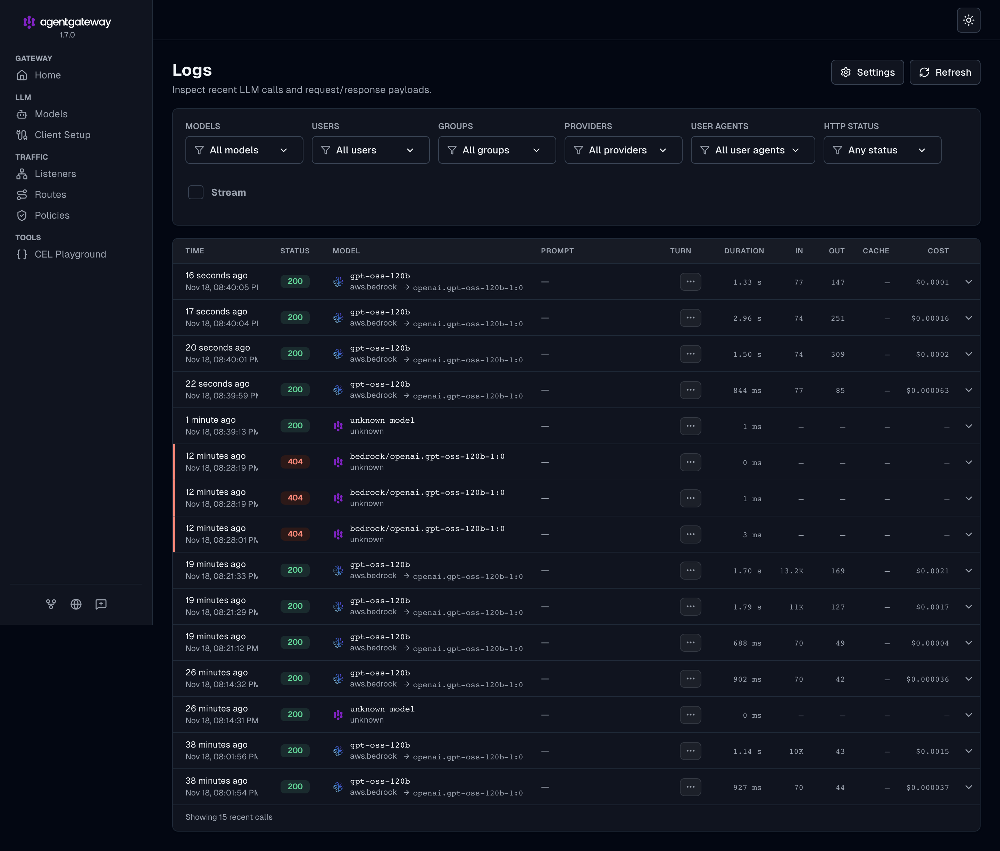
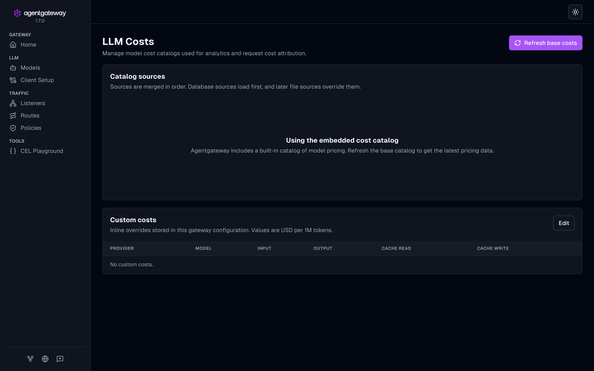
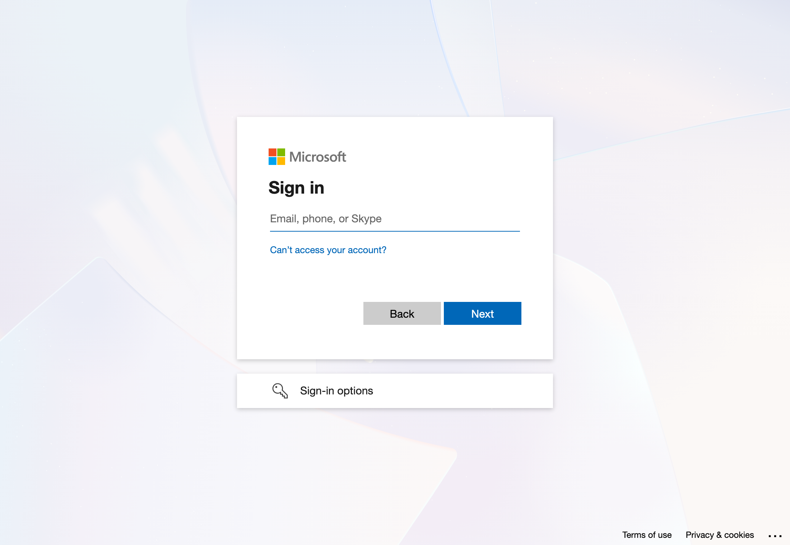

# Codex CLI through agentgateway on kind

Routes OpenAI Codex CLI traffic through [agentgateway](https://agentgateway.dev/docs/kubernetes/latest/) running in a local kind cluster. The gateway holds the Bedrock API key and serves OpenAI's `gpt-oss-120b` from Amazon Bedrock; Codex talks to the gateway with no key of its own.

```
codex CLI ──► localhost:<port> ──► cloud-provider-kind (envoy) ──► agentgateway-proxy
 (no API key)                                                          │
                                                                       ├─ /v1/*  ──► Amazon Bedrock us-east-2 (gateway adds the key)
                                                                       ├─ /mcp   ──► https://search.solo.io/mcp
                                                                       └─ logs   ──► Postgres ──► UI Logs / Analytics
```



Based on:

- LLM quickstart (models): <https://agentgateway.dev/docs/kubernetes/latest/quickstart/llm/>
- Bedrock provider: <https://agentgateway.dev/docs/kubernetes/latest/llm/providers/bedrock/>
- Install: <https://agentgateway.dev/docs/kubernetes/latest/quickstart/install/>
- OpenAI provider: <https://agentgateway.dev/docs/kubernetes/latest/llm/providers/openai/>
- Cost dashboard / request-log database: <https://agentgateway.dev/docs/kubernetes/latest/documentation/llm/cost-controls/dashboard/>
- Remote MCP over HTTPS: <https://agentgateway.dev/docs/kubernetes/latest/mcp/https/>
- Codex client: <https://agentgateway.dev/docs/kubernetes/latest/integrations/llm/clients/codex/>

## Versions used

| Component | Version |
|---|---|
| kind | v0.30.0 (node image `kindest/node:v1.34.0`) |
| Gateway API CRDs | v1.6.3 (standard channel) |
| agentgateway (Helm) | v1.7.0 |
| Helm | v4.0.5 |
| Codex CLI | 0.170.0 |
| Docker Desktop | 28.5.1 (macOS, arm64) |

## What gets deployed

| Piece | How | Where |
|---|---|---|
| Gateway API CRDs v1.6.3 | `kubectl apply` | Step 3 |
| agentgateway CRDs + controller v1.7.0 | Helm (2 releases) | Step 4 |
| Postgres for request logs | manifest `k8s/03-postgres.yaml` | Step 5 |
| Proxy database settings | manifest `k8s/04-gateway-parameters.yaml` | Step 5 |
| Gateway → proxy Deployment + LoadBalancer | manifest `k8s/01-gateway.yaml` | Step 6 |
| Model `gpt-oss-120b` (OpenAI on Bedrock) | manifest `k8s/02-model-bedrock-openai.yaml` | Step 7 |
| MCP server `search.solo.io` at `/mcp` | manifest `k8s/05-mcp-solo-search.yaml` | Step 12 |
| Codex profile | `~/.codex/agentgateway.config.toml` | Steps 10 and 12 |
| *Optional:* models `gpt-oss-20b` and `claude-haiku-4-5` | manifest `k8s/07-more-bedrock-models.yaml` | [Other models](#other-models) |
| *Optional:* Entra ID sign-in + group check | manifest `k8s/06-entra-auth.yaml` | [Optional section](entra-id/README.md) |

Secrets (`bedrock-secret`, `agentgateway-db`) are created from the command line and are not stored in
this directory.

## Prerequisites

- Docker Desktop running
- `kind`, `kubectl`, `helm`, `jq`, `openssl`, `cloud-provider-kind`, `codex` on your `PATH`
- `BEDROCK_API_KEY` exported in your shell (Bedrock console → API keys)

Every `kubectl`/`helm` command below pins the context so nothing lands on another cluster by accident:

```sh
export CTX=kind-agentgateway-codex
```

## Step 1 — Create the kind cluster

```sh
kind create cluster --name agentgateway-codex
kubectl --context $CTX get nodes
```

> `kind create cluster` switches your current kubectl context to `kind-agentgateway-codex`.
> Switch back with `kubectl config use-context <name>` when you are done.

## Step 2 — Start cloud-provider-kind

cloud-provider-kind gives `LoadBalancer` Services an external IP. Run it in a **separate terminal** and leave it running:

```sh
cloud-provider-kind --gateway-channel disabled --enable-lb-port-mapping
```

Why these flags:

- `--gateway-channel disabled` — by default cloud-provider-kind installs its own Gateway API CRDs and gateway controller. We install the CRDs ourselves (v1.6.3) and use agentgateway as the controller.
- `--enable-lb-port-mapping` — on macOS the Docker network (`172.18.0.0/16`) is not reachable from the host. With this flag each LoadBalancer is published on a random `localhost` port, and no `sudo` is needed.

**Alternative (sudo):** `sudo cloud-provider-kind --gateway-channel disabled` runs in tunnel mode, which makes the LoadBalancer IP itself reachable from the Mac on port 80. Without `sudo` and without `--enable-lb-port-mapping` it exits with ``please run this again with `sudo` ``.

## Step 3 — Install the Gateway API CRDs

```sh
export GWAPI_VERSION=1.6.3
kubectl --context $CTX apply --server-side --force-conflicts \
  -f https://github.com/kubernetes-sigs/gateway-api/releases/download/v$GWAPI_VERSION/standard-install.yaml
```

## Step 4 — Install agentgateway

```sh
# CRDs
helm upgrade -i agentgateway-crds oci://cr.agentgateway.dev/charts/agentgateway-crds \
  --kube-context $CTX \
  --create-namespace --namespace agentgateway-system \
  --version v1.7.0

# Control plane
helm upgrade -i agentgateway oci://cr.agentgateway.dev/charts/agentgateway \
  --kube-context $CTX \
  --namespace agentgateway-system \
  --version v1.7.0 \
  --set controller.image.pullPolicy=Always \
  --wait
```

Verify:

```sh
kubectl --context $CTX get pods -n agentgateway-system     # agentgateway-xxxx  1/1 Running
kubectl --context $CTX get gatewayclass agentgateway       # ACCEPTED=True
```

## Step 5 — Deploy the request-log database (Postgres)

The UI's **Logs**, **Analytics** and **Costs** pages read from a request-log database. Without one they
show `request log database is not configured`. This setup runs Postgres in the cluster. Do this before
creating the Gateway, because the Gateway references the parameters created here.

Create a password Secret and deploy Postgres — [`k8s/03-postgres.yaml`](k8s/03-postgres.yaml)
(StatefulSet, 1 replica, 5Gi PersistentVolumeClaim, in `agentgateway-system`):

```sh
kubectl --context $CTX -n agentgateway-system create secret generic agentgateway-db \
  --from-literal=password="$(openssl rand -hex 24)"
kubectl --context $CTX apply -f k8s/03-postgres.yaml
kubectl --context $CTX -n agentgateway-system rollout status statefulset/agentgateway-db
```

Create the proxy parameters that point at it — [`k8s/04-gateway-parameters.yaml`](k8s/04-gateway-parameters.yaml).
There is no typed field (and no Helm value) for the database, so it goes through `rawConfig` on an
`AgentgatewayParameters`. The file holds a `${PG_PASSWORD}` placeholder so the password stays out of this
directory:

```sh
PG_PASSWORD=$(kubectl --context $CTX -n agentgateway-system get secret agentgateway-db \
  -o jsonpath='{.data.password}' | base64 -d)
sed "s/\${PG_PASSWORD}/$PG_PASSWORD/" k8s/04-gateway-parameters.yaml | kubectl --context $CTX apply -f -
```

Notes:

- The database setting is read at startup only; changing it restarts the proxy.
- **Prompt logging is on.** `k8s/04-gateway-parameters.yaml` sets
  `frontendPolicies.accessLog.database.llm: full`, so the prompt and completion text of every call is
  stored in Postgres (table `request_log_payloads`) and shown under each entry on the Logs page. Change
  it to `metadata` to keep only model, tokens, cost, latency, status and client. The UI's
  *Log settings* panel cannot change this on Kubernetes (read-only mode); the file is the way.
- The password ends up in plain text inside the `AgentgatewayParameters` resource and the proxy's
  ConfigMap, because `rawConfig` has no Secret reference. Restrict read access to that namespace.
- No retention or pruning setting is documented; the `request_logs` table grows until you prune it.

### Where to run the database

| Option | Use when |
|---|---|
| SQLite file in the proxy pod (`sqlite:////tmp/data.db?mode=rwc`) | Quick look only. One DB per pod, lost on restart, breaks with more than one proxy replica. |
| Postgres in the cluster (this setup) | Dev, demos, kind. Survives proxy restarts; works with multiple proxy replicas. |
| Managed Postgres outside the cluster (RDS, Cloud SQL, …) | Production. The agentgateway docs call in-cluster Postgres testing-only and recommend a managed service. |
| Postgres operator in the cluster (e.g. CloudNativePG) | Production when the data must stay in-cluster; gives you backups and failover. |

## Step 6 — Create the Gateway (proxy)

[`k8s/01-gateway.yaml`](k8s/01-gateway.yaml):

```sh
kubectl --context $CTX apply -f k8s/01-gateway.yaml
kubectl --context $CTX -n agentgateway-system rollout status deploy/agentgateway-proxy
```

The controller (not Helm) creates the `agentgateway-proxy` Deployment and a `LoadBalancer` Service on
port 80 from this resource. The Gateway also:

- allows `AgentgatewayModel` to attach (`allowedRoutes.kinds`), and
- loads the database settings from Step 5 (`spec.infrastructure.parametersRef`). If those parameters do
  not exist yet, the Gateway stays `Programmed=False` and no proxy is created.

## Step 7 — Configure the model (OpenAI gpt-oss-120b on Bedrock)

This step publishes one model: OpenAI's `gpt-oss-120b`, served by Amazon Bedrock. To add
`gpt-oss-20b` and Claude Haiku 4.5 afterwards, see [Other models](#other-models).

Store the Bedrock API key in a Secret. It is read from your environment and never written to a file:

```sh
export BEDROCK_API_KEY='<your Bedrock API key>'

kubectl --context $CTX -n agentgateway-system create secret generic bedrock-secret \
  --from-literal=Authorization="$BEDROCK_API_KEY"
```

Apply the model — [`k8s/02-model-bedrock-openai.yaml`](k8s/02-model-bedrock-openai.yaml):

```sh
kubectl --context $CTX apply -f k8s/02-model-bedrock-openai.yaml
kubectl --context $CTX -n agentgateway-system get agentgatewaymodel
```

How it works:

- The `AgentgatewayModel` attaches to the Gateway listener. The Gateway must list `AgentgatewayModel`
  under `allowedRoutes.kinds` (see `k8s/01-gateway.yaml`).
- Clients ask for `gpt-oss-120b` (the resource name). A `model` transformation rewrites that to the
  Bedrock model ID `openai.gpt-oss-120b-1:0`.
- Any other model name returns `404 model_not_found`.
- **Bedrock API key auth** uses `policies.auth.secretRef` (bearer token, Secret key `Authorization`).
  `policies.auth.aws.secretRef` is for IAM access keys and fails with `accessKey is missing`.
- **Region** is `spec.bedrock.region` (`us-east-2` here).

## Step 8 — Get the gateway address

```sh
kubectl --context $CTX get svc -n agentgateway-system agentgateway-proxy   # EXTERNAL-IP is assigned, e.g. 172.18.0.3
```

With `--enable-lb-port-mapping` (Step 2), use the host port that cloud-provider-kind published:

```sh
export INGRESS_GW_ADDRESS=localhost:$(docker port $(docker ps --filter name=kindccm -q) 80/tcp | head -1 | awk -F: '{print $NF}')
echo $INGRESS_GW_ADDRESS        # e.g. localhost:60597
```

If you ran cloud-provider-kind with `sudo` instead, use the LoadBalancer IP directly:

```sh
export INGRESS_GW_ADDRESS=$(kubectl --context $CTX get svc -n agentgateway-system agentgateway-proxy \
  -o jsonpath="{.status.loadBalancer.ingress[0].ip}")
```

> The mapped port is random. It changes whenever the `kindccm-*` container is recreated (for example
> after restarting cloud-provider-kind or Docker). When it does, redo this step and Steps 10 and 12.

## Step 9 — Test the gateway

Note there is no `Authorization` header — the gateway adds it.

```sh
# Model list published by the gateway  ->  gpt-oss-120b
curl -s "http://$INGRESS_GW_ADDRESS/v1/models" | jq -r '.data[].id'

# Responses API (what Codex uses)
curl -s "http://$INGRESS_GW_ADDRESS/v1/responses" -H content-type:application/json \
  -d '{"model":"gpt-oss-120b","input":"Say hello in one sentence."}' | jq '.output[-1].content[0].text'
```

## Step 10 — Point Codex at the gateway

Create a Codex profile. This is a separate file, so your existing `~/.codex/config.toml` is untouched:

```sh
export AGENTGATEWAY_BASE_URL="http://${INGRESS_GW_ADDRESS}/v1"

cat > ~/.codex/agentgateway.config.toml <<EOF
model = "gpt-oss-120b"
model_provider = "agentgateway"

[model_providers.agentgateway]
name = "OpenAI via agentgateway"
base_url = "${AGENTGATEWAY_BASE_URL}"
wire_api = "responses"
EOF
```

- The `/v1` suffix is required — Codex posts to `<base_url>/responses`.
- `wire_api = "responses"` is required — Codex uses the Responses API, not chat completions.
- No `env_key` is set, so Codex sends no credential. The gateway supplies the Bedrock key.
- `model` must be the name the gateway publishes.

Run Codex with the profile:

```sh
codex --profile agentgateway                    # interactive
codex exec --profile agentgateway "Hello"       # one-shot
```

One-off alternative without a profile file:

```sh
codex -c model_provider='"agentgateway"' \
  -c model_providers.agentgateway.name='"OpenAI via agentgateway"' \
  -c model_providers.agentgateway.base_url="\"${AGENTGATEWAY_BASE_URL}\"" \
  -c model_providers.agentgateway.wire_api='"responses"'
```

## Step 11 — Verify Codex traffic goes through the gateway

```sh
codex exec --profile agentgateway --skip-git-repo-check "Reply with exactly: hello from agentgateway"

kubectl --context $CTX logs deployment/agentgateway-proxy -n agentgateway-system --since=5m \
  | grep 'http.path=/v1/responses' | tail -n 5
```

A successful entry looks like this (trimmed):

```
info request gateway=agentgateway-system/agentgateway-proxy route=internal/llm:request
  endpoint=bedrock-runtime.us-east-2.amazonaws.com:443 http.method=POST http.path=/v1/responses
  http.status=200 protocol=llm gen_ai.provider.name=aws.bedrock
  gen_ai.request.model=openai.gpt-oss-120b-1:0 agw.ai.original_model=gpt-oss-120b
```

## Step 12 — Add an MCP server (Solo.io docs search)

[`k8s/05-mcp-solo-search.yaml`](k8s/05-mcp-solo-search.yaml) exposes the remote MCP server
`https://search.solo.io/mcp` on the gateway at `/mcp`: an `AgentgatewayBackend` with a static MCP target
(host, port 443, path `/mcp`, TLS SNI) plus an `HTTPRoute` matching the `/mcp` prefix. No credentials are
needed; the server is public. It coexists with the `AgentgatewayModel` on the same listener.

```sh
kubectl --context $CTX apply -f k8s/05-mcp-solo-search.yaml
kubectl --context $CTX -n agentgateway-system get agentgatewaybackend,httproute
```

Test (streamable HTTP; the gateway returns an `mcp-session-id` header to reuse on later calls):

```sh
curl -si -X POST "http://$INGRESS_GW_ADDRESS/mcp" \
  -H 'content-type: application/json' -H 'accept: application/json, text/event-stream' \
  -d '{"jsonrpc":"2.0","id":1,"method":"initialize","params":{"protocolVersion":"2025-03-26","capabilities":{},"clientInfo":{"name":"curl","version":"0"}}}'
```

Tools exposed: `search`, `get_chunks`, `get_full_page`.

Use it from Codex by appending it to the profile from Step 10:

```sh
cat >> ~/.codex/agentgateway.config.toml <<EOF

[mcp_servers.solo-search]
url = "http://${INGRESS_GW_ADDRESS}/mcp"
EOF

codex exec --profile agentgateway --skip-git-repo-check \
  "Use the solo-search MCP search tool to look up: AgentgatewayModel. Summarize the top result."
```

What you can see for MCP in the UI on Kubernetes:

- **Traffic → Routes** lists the `solo-search-mcp` route (`/mcp`) next to the LLM route.
- There is no MCP section in the sidebar, and `/ui/mcp/servers` by URL shows "No MCP servers
  configured" — that page reads the local config file, which is empty when Kubernetes manages config.
- MCP calls are **not** written to the request-log database, so they do not appear on the Logs or
  Analytics pages. They are in the proxy's stdout access log with `protocol=mcp`:

  ```sh
  kubectl --context $CTX logs deployment/agentgateway-proxy -n agentgateway-system --since=10m \
    | grep 'protocol=mcp' | grep -o 'mcp.method.name=[^ ]*\|mcp.target=[^ ]*\|http.status=[0-9]*' | paste - - -
  ```

## Step 13 — Open the UI (logs, analytics, costs)

The proxy serves a built-in admin UI on port `15000`. It listens on `127.0.0.1` inside the pod and is not
exposed by any Service, so reach it with a port-forward (rerun it whenever the proxy pod is replaced):

```sh
kubectl --context $CTX -n agentgateway-system port-forward deploy/agentgateway-proxy 15000:15000
```

Open <http://localhost:15000/ui>. The same port serves the raw config at `/config_dump`.

**Logs, Analytics and Costs are not in the sidebar on Kubernetes.** When config is managed by the
control plane the proxy reports `gatewayMode: xds`, the UI shows a "Readonly mode" banner, and its menu
is fixed to Models, Client Setup, Listeners, Routes, Policies and CEL Playground. There is no Helm value
or config option that changes this in v1.7.0. The pages still work — open them by URL:

- <http://localhost:15000/ui/llm/logs> — each LLM call: model, tokens, duration, cost
- <http://localhost:15000/ui/llm/analytics> — traffic by model, user, provider
- <http://localhost:15000/ui/llm/costs> — the built-in pricing catalog

| Logs (`/ui/llm/logs`) | Analytics (`/ui/llm/analytics`) |
|---|---|
|  |  |

| Models | Routes |
|---|---|
|  |  |

| Home (note the "Readonly mode" banner and short sidebar) | Costs (`/ui/llm/costs`) |
|---|---|
|  |  |

The screenshots are generated with Playwright. To refresh them, keep the port-forward above running and:

```sh
npm install
npx playwright install chromium
npm run screenshots        # writes docs/screenshots/*.png
```

Or query the database directly:

```sh
kubectl --context $CTX -n agentgateway-system exec agentgateway-db-0 -- \
  psql -U agentgateway -d agentgateway -c \
  'select started_at, gen_ai_request_model, total_tokens, cost, user_agent_name from request_logs order by started_at desc limit 5'
```

## Optional — Entra ID sign-in

To make Codex sign in with Microsoft Entra ID before it can use the gateway, and to allow only members
of one group, follow the separate guide: **[entra-id/README.md](entra-id/README.md)**.

It covers the Entra group and app registration, the gateway policies, the Codex sign-in for the model
and the MCP server, and showing the signed-in user in the logs.



## Other models

[`k8s/07-more-bedrock-models.yaml`](k8s/07-more-bedrock-models.yaml) publishes two more Bedrock models
next to `gpt-oss-120b`. They use the same `bedrock-secret` and region:

```sh
kubectl --context $CTX apply -f k8s/07-more-bedrock-models.yaml
codex --profile agentgateway -m claude-haiku-4-5      # or: -m gpt-oss-20b
```

| Name in Codex | Bedrock model | Result with Codex |
|---|---|---|
| `gpt-oss-120b` | `openai.gpt-oss-120b-1:0` | works: chat, shell commands, MCP tools |
| `gpt-oss-20b` | `openai.gpt-oss-20b-1:0` | works: chat, shell commands, MCP tools. Sometimes prints its reasoning in front of the answer |
| `claude-haiku-4-5` | `us.anthropic.claude-haiku-4-5-20251001-v1:0` | works: chat, shell commands, MCP tools, after the change below |

**Claude models need two Codex tools turned off if you have the ChatGPT desktop app installed.** The app
adds two JavaScript REPL tools to Codex (`cua_repl` from the `unified-computer-use` plugin, and
`node_repl`). Their schemas use a top-level `oneOf`, which Claude on Bedrock rejects for the whole
request:

```
HTTP 400: tools.12.custom.input_schema: input_schema does not support oneOf, allOf, or anyOf at the top level
```

Turn them off for the gateway profile only. Add each block only if `codex mcp list` shows that server,
otherwise Codex refuses to load the profile:

```sh
cat >> ~/.codex/agentgateway.config.toml <<'EOF'

# Claude on Bedrock rejects the schema of these two desktop-app tools.
[plugins."unified-computer-use@openai-bundled"]
enabled = false

[mcp_servers.node_repl]
enabled = false
EOF
```

Any other MCP tool whose schema has `oneOf`, `anyOf` or `allOf` at the top level causes the same error
with Claude models. The OpenAI models on Bedrock accept them.

OpenAI direct (`gpt-5.5`, `gpt-6.2-sol`) with `provider: OpenAI` and an `openai-secret` was also tested
with Codex earlier and worked; it is not in a manifest here.

To add another model, copy a block in `k8s/07-more-bedrock-models.yaml` and change `metadata.name` and
the model ID in the transformation.

## Things to know

- **The gateway is unauthenticated by default.** Anyone who can reach the port can use your Bedrock key. With
  `--enable-lb-port-mapping` the port is published on `0.0.0.0`, i.e. reachable from your LAN, not just
  localhost. Fine for a short local test; on an untrusted network, stop cloud-provider-kind when you are
  done or use `kubectl port-forward` (next bullet), which binds to `127.0.0.1` only. To require a sign-in,
  do the [optional Entra ID section](entra-id/README.md).
- **Stable-port alternative:** skip cloud-provider-kind and run
  `kubectl --context $CTX port-forward deployment/agentgateway-proxy -n agentgateway-system 8080:80`,
  then use `INGRESS_GW_ADDRESS=localhost:8080`.
- **`codex exec` from a script** waits on stdin if it is not a TTY; add `</dev/null`.
- **ChatGPT desktop app:** the docs cover this by replacing `~/.codex/config.toml`. Not done here, because
  that file holds existing plugin/MCP settings. To do it, merge the four keys from Step 10 into that file
  (back it up first) and restart the app.
- **Rotating the key:**
  ```sh
  kubectl --context $CTX -n agentgateway-system create secret generic bedrock-secret \
    --from-literal=Authorization="$BEDROCK_API_KEY" --dry-run=client -o yaml \
    | kubectl --context $CTX apply -f -
  ```

## Cleanup

```sh
rm ~/.codex/agentgateway.config.toml
pkill cloud-provider-kind                     # or Ctrl-C in its terminal
kind delete cluster --name agentgateway-codex    # also deletes the Postgres data
docker rm -f $(docker ps -aq --filter name=kindccm) 2>/dev/null
```
