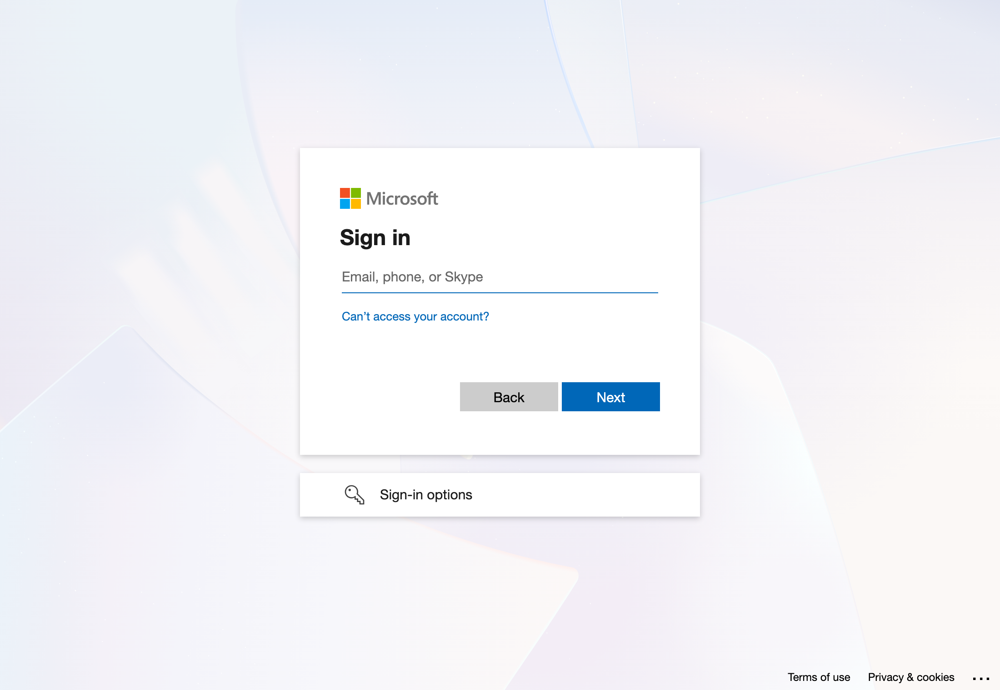
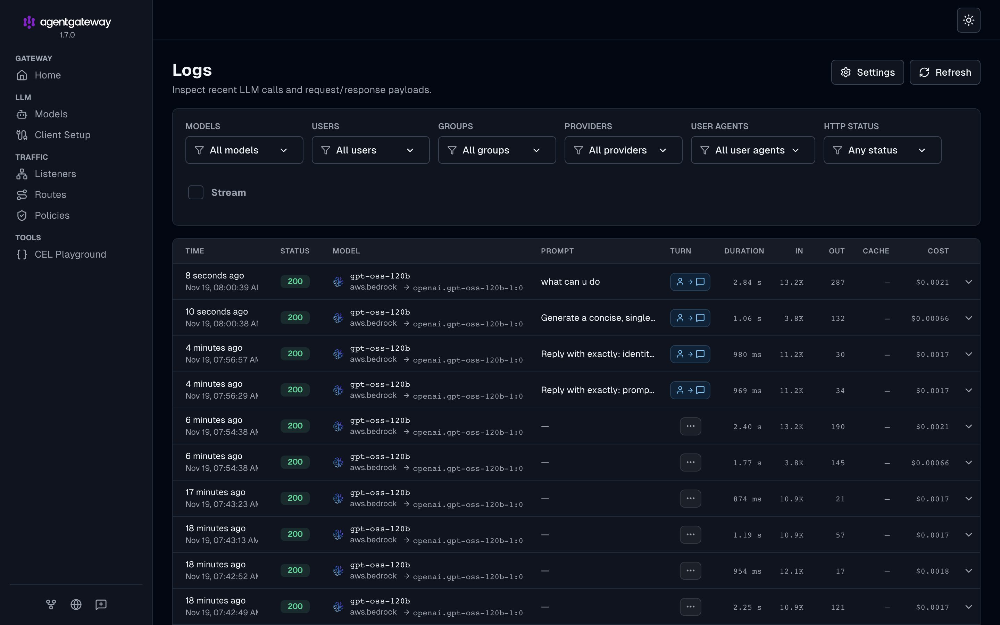
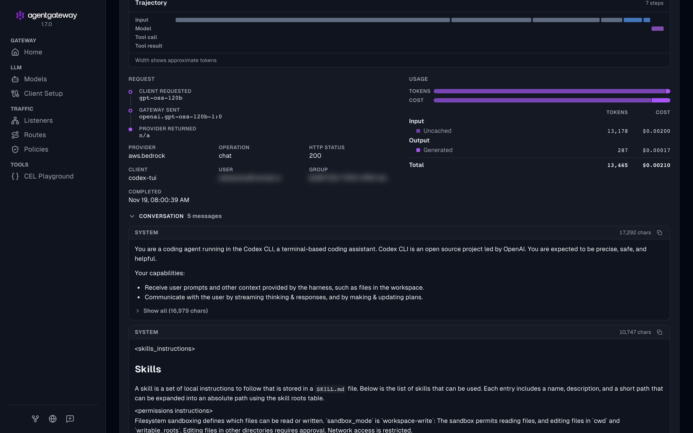

# Entra ID sign-in for Codex CLI through agentgateway

This guide adds Microsoft Entra ID sign-in on top of the [base setup](../README.md). When you are done:

- You type `codex`. If you have no valid sign-in, Codex opens the Microsoft sign-in page first.
- The gateway only lets requests through that carry an Entra token **and** belong to a member of the
  `codex` group. That covers the model (`/v1`) and the search MCP server (`/mcp`).
- The Logs page shows who made each call, with the prompt and the answer.



```
you type `codex`
      │  no valid sign-in yet? Codex opens the Microsoft sign-in page in your browser
      ▼
Entra ID ── token with your group IDs ──► Codex ── Authorization: Bearer <token> ──► agentgateway-proxy
                                                     1. valid token from my tenant, for my app?  no → 401
                                                     2. "codex" group ID in the token's groups?  no → 403
                                                     3. yes → Bedrock (/v1) and search.solo.io (/mcp)
```

For Claude Code instead of Codex, do Steps 1–3 here and then follow
[claude-code/README.md](../claude-code/README.md#step-5--optional-entra-id-sign-in).

Everything here is open source agentgateway (v1.7.0): `AgentgatewayPolicy` with `jwtAuthentication` and
`authorization`. On the client side it uses two features built into Codex CLI (tested with 0.170.0):
gateway OAuth for the model provider, and MCP OAuth for the MCP server. Codex stores and refreshes the
tokens itself.

## What gets created

| Piece | Where | Step |
|---|---|---|
| Group `codex` | Entra ID | 1 |
| App registration `agentgateway-oss-codex` | Entra ID | 2 |
| Policies `entra-auth` and `entra-auth-mcp` | cluster, [`k8s/06-entra-auth.yaml`](../k8s/06-entra-auth.yaml) | 4 |
| Codex profile with sign-in settings | `~/.codex/agentgateway.config.toml` | 6 |
| MCP callback redirect URI | Entra ID app registration | 8 |
| `codex` alias | `~/.zshrc` | 9 |
| Sign-in name in request logs | cluster, proxy parameters | 10 |

No secret is created: the app registration is a public client (sign-in with PKCE, no client secret),
and the tenant, app and group IDs are filled into the manifest at apply time.

## Before you begin

- The base setup works: the gateway from the [main README](../README.md) is built, and with the
  profile from [codex/README.md](../codex/README.md) `codex --profile agentgateway` reaches the model
  and the `solo-search` MCP server.
- These variables from the main guide are set in your shell:

  ```sh
  export CTX=kind-agentgateway-codex
  echo $INGRESS_GW_ADDRESS        # e.g. localhost:8080, from Step 8
  ```

- The Azure CLI (`az`), signed in as a user who may create groups and app registrations. It is only
  needed for setup; using Codex afterwards does not need `az`.

  ```sh
  az login
  export TENANT_ID=$(az account show --query tenantId -o tsv)
  ```

Run all commands from the repository root.

## Step 1 — Create the group and add yourself

```sh
export GROUP_ID=$(az ad group create --display-name codex --mail-nickname codex \
  --description "Access to LLMs and MCP servers through agentgateway" --query id -o tsv)

az ad group member add --group $GROUP_ID \
  --member-id $(az ad signed-in-user show --query id -o tsv)
```

To use a group that already exists instead:
`export GROUP_ID=$(az ad group show --group <name> --query id -o tsv)`.

## Step 2 — Create the app registration

The app registration represents the gateway. The gateway only accepts tokens issued *for this app*, so a
token for some other API in your tenant does not work.

```sh
export APP_ID=$(az ad app create --display-name agentgateway-oss-codex \
  --sign-in-audience AzureADMyOrg --query appId -o tsv)
OBJECT_ID=$(az ad app show --id $APP_ID --query id -o tsv)

# Application ID URI, and put the user's security groups in the token
az ad app update --id $APP_ID --identifier-uris "api://$APP_ID" \
  --set groupMembershipClaims=SecurityGroup

# Expose one scope ("access") and issue v2.0 tokens
SCOPE_ID=$(uuidgen | tr 'A-Z' 'a-z')
az rest --method PATCH --uri "https://graph.microsoft.com/v1.0/applications/$OBJECT_ID" \
  --headers 'Content-Type=application/json' --body "{
    \"api\": {
      \"requestedAccessTokenVersion\": 2,
      \"oauth2PermissionScopes\": [{
        \"id\": \"$SCOPE_ID\", \"value\": \"access\", \"type\": \"User\", \"isEnabled\": true,
        \"adminConsentDisplayName\": \"Access agentgateway\",
        \"adminConsentDescription\": \"Call LLMs and MCP servers through agentgateway\",
        \"userConsentDisplayName\": \"Access agentgateway\",
        \"userConsentDescription\": \"Call LLMs and MCP servers through agentgateway\"
      }]
    }
  }"

# Let the Azure CLI request that scope without a consent prompt, so you can fetch a
# test token in Steps 3 and 5 (04b07795-... is Microsoft's fixed client ID for the Azure CLI)
az rest --method PATCH --uri "https://graph.microsoft.com/v1.0/applications/$OBJECT_ID" \
  --headers 'Content-Type=application/json' --body "{
    \"api\": { \"preAuthorizedApplications\": [{
      \"appId\": \"04b07795-8ddb-461a-bbee-02f9e1bf7b46\", \"delegatedPermissionIds\": [\"$SCOPE_ID\"]
    }] }
  }"

# Let Codex sign users in: public client (no secret) with loopback redirect URIs.
# Entra ignores the port of a loopback URI but matches the path exactly.
az rest --method PATCH --uri "https://graph.microsoft.com/v1.0/applications/$OBJECT_ID" \
  --headers 'Content-Type=application/json' --body '{
    "isFallbackPublicClient": true,
    "publicClient": { "redirectUris": ["http://127.0.0.1/callback", "http://localhost/callback"] }
  }'

# The app needs a service principal in the tenant before tokens can be issued for it
az ad sp create --id $APP_ID
```

What each setting is for:

| Setting | Why |
|---|---|
| Application ID URI `api://<APP_ID>` + scope `access` | Gives Codex something to ask a token for |
| `requestedAccessTokenVersion: 2` | Tokens get the v2.0 issuer the policy checks. Without it sign-in works but the gateway answers 401 |
| `groupMembershipClaims: SecurityGroup` | Puts your group IDs in the token, which the policy checks |
| Public client + `http://127.0.0.1/callback` | Lets Codex finish the browser sign-in on your machine without a client secret |

<details>
<summary>The same thing in the Azure portal</summary>

1. **Entra ID → App registrations → New registration.** Name `agentgateway-oss-codex`, single tenant.
2. **Expose an API.** Set the Application ID URI (accept `api://<client-id>`), then **Add a scope**
   named `access`, consent by *Admins and users*. Under *Authorized client applications* add
   `04b07795-8ddb-461a-bbee-02f9e1bf7b46` (Azure CLI) for that scope.
3. **Token configuration → Add groups claim → Security groups.**
4. **Manifest.** Set `"requestedAccessTokenVersion": 2` under `api`.
5. **Authentication → Add a platform → Mobile and desktop applications.** Add
   `http://localhost/callback`. Do not use the *Web* platform; that would require a client secret.
   `http://127.0.0.1/...` URIs can only be added in the manifest (`publicClient.redirectUris`) or
   with the command above. Set *Allow public client flows* to **Yes**.
6. **Entra ID → Groups → New group.** Type *Security*, name `codex`, add members.

The portal steps were not run for this guide; the commands above were.

</details>

## Step 3 — Check the token

It can take a minute after Step 2 before Entra issues the token.

```sh
az account get-access-token --scope api://$APP_ID/.default --query accessToken -o tsv \
  | cut -d. -f2 | python3 -c "
import sys, base64, json
p = sys.stdin.read().strip(); p += '=' * (-len(p) % 4)
c = json.loads(base64.urlsafe_b64decode(p))
print(json.dumps({k: c.get(k) for k in ['iss', 'aud', 'scp', 'groups']}, indent=2))"
```

Expect:

- `iss` ends in `/<TENANT_ID>/v2.0`
- `aud` equals `$APP_ID`
- `scp` is `access`
- `groups` contains `$GROUP_ID`

## Step 4 — Apply the gateway policies

[`k8s/06-entra-auth.yaml`](../k8s/06-entra-auth.yaml) holds two policies:

| Policy | Attached to | What it does |
|---|---|---|
| `entra-auth` | the Gateway | Requires a valid token and the group for everything, including `/v1` |
| `entra-auth-mcp` | the `solo-search-mcp` route | Same checks, plus `mcp.provider: Entra` so the gateway serves the OAuth discovery endpoints that `codex mcp login` needs |

The file has three placeholders that are filled in at apply time:

```sh
kubectl --context $CTX apply -f k8s/05-mcp-solo-search.yaml   # the route also matches /.well-known/oauth-*

sed -e "s/\${TENANT_ID}/$TENANT_ID/g" -e "s/\${APP_ID}/$APP_ID/g" -e "s/\${GROUP_ID}/$GROUP_ID/g" \
  k8s/06-entra-auth.yaml | kubectl --context $CTX apply -f -

kubectl --context $CTX -n agentgateway-system get agentgatewaypolicy \
  -o custom-columns='NAME:.metadata.name,ACCEPTED:.status.ancestors[0].conditions[?(@.type=="Accepted")].status,ATTACHED:.status.ancestors[0].conditions[?(@.type=="Attached")].status'
# NAME             ACCEPTED   ATTACHED
# entra-auth       True       True
# entra-auth-mcp   True       True
```

The core of both policies:

```yaml
traffic:
  jwtAuthentication:            # who are you?  → 401 if the token is missing or invalid
    mode: Strict
    providers:
    - issuer: https://login.microsoftonline.com/<TENANT_ID>/v2.0
      audiences: [<APP_ID>]
      jwks:
        remote:
          url: https://login.microsoftonline.com/<TENANT_ID>/discovery/v2.0/keys
    mcp:                        # only on the MCP route
      provider: Entra           # bridges the gaps between Entra and the MCP auth spec
      clientId: <APP_ID>        # Entra has no dynamic client registration
  authorization:                # are you allowed?  → 403 if not in the group
    action: Allow
    policy:
      matchExpressions:
      - '"<GROUP_ID>" in jwt.groups'
```

From this moment the gateway rejects Codex until you finish Steps 6–8.

## Step 5 — Test the gateway with curl

```sh
BODY='{"model":"gpt-oss-120b","messages":[{"role":"user","content":"Say hi in 3 words"}]}'

# no token → 401
curl -s -o /dev/null -w "%{http_code}\n" "$INGRESS_GW_ADDRESS/v1/chat/completions" \
  -H 'content-type: application/json' -d "$BODY"

# with your token → 200
TOKEN=$(az account get-access-token --scope api://$APP_ID/.default --query accessToken -o tsv)
curl -s -o /dev/null -w "%{http_code}\n" "$INGRESS_GW_ADDRESS/v1/chat/completions" \
  -H 'content-type: application/json' -H "Authorization: Bearer $TOKEN" -d "$BODY"
```

Results from this setup:

| Request | LLM `/v1` | MCP `/mcp` |
|---|---|---|
| No token | 401 | 401 |
| Garbage token | 401 | 401 |
| Valid Entra token for a different API | 401 | not tested |
| Valid token, group not matching | 403 `authorization failed` | 403 |
| Valid token, user in the group | 200 | 200 |

The "group not matching" row was tested by pointing the policy at a group ID that does not exist.

## Step 6 — Update the Codex profile

Rewrite the profile from the [Codex guide](../codex/README.md). The `gateway_oauth` table tells Codex where to sign you in:

```sh
cat > ~/.codex/agentgateway.config.toml <<EOF
model = "gpt-oss-120b"
model_provider = "agentgateway"

[model_providers.agentgateway]
name = "agentgateway"
base_url = "http://${INGRESS_GW_ADDRESS}/v1"
wire_api = "responses"

# Codex signs you in with Microsoft Entra ID before it calls the gateway.
[model_providers.agentgateway.gateway_oauth]
authorization_url = "https://login.microsoftonline.com/${TENANT_ID}/oauth2/v2.0/authorize"
token_url = "https://login.microsoftonline.com/${TENANT_ID}/oauth2/v2.0/token"
client_id = "${APP_ID}"
scopes = ["api://${APP_ID}/access", "offline_access"]

# Sign in once with: codex --profile agentgateway mcp login solo-search
[mcp_servers.solo-search]
url = "http://${INGRESS_GW_ADDRESS}/mcp"
EOF
```

No token or secret goes in this file. If you added the two blocks that make Claude models work
(see [Other models](../codex/README.md#other-models)), add them again at the end, because this command
replaces the file.

## Step 7 — Sign in for the model

```sh
codex --profile agentgateway
```

Codex opens the Microsoft sign-in page in your browser. If it cannot open a browser it prints the link:

```
Authorize the model provider by opening this URL:
https://login.microsoftonline.com/<TENANT_ID>/oauth2/v2.0/authorize?response_type=code&client_id=...
```

Sign in with an account that is in the `codex` group. Codex then starts and your prompts go through
the gateway. The token is kept encrypted in `~/.codex/secrets/` and refreshed automatically, so later
runs do not ask again.

## Step 8 — Sign in for the MCP server

The MCP server has its own sign-in. Codex uses a callback path that ends in an ID derived from the MCP
server URL, and Entra must know that exact path. Print it:

```sh
codex --profile agentgateway mcp login solo-search --no-browser </dev/null 2>&1 \
  | grep -oE 'redirect_uri=[^&]+' | python3 -c "import sys, urllib.parse as u; print(u.unquote(sys.stdin.read()))"
# redirect_uri=http://127.0.0.1:63884/callback/dFBqJtJnaDT6      ← your ID will differ
```

Register that path (without the port) on the app, next to the two from Step 2:

```sh
CALLBACK_ID=<the last path segment, e.g. dFBqJtJnaDT6>
az rest --method PATCH --uri "https://graph.microsoft.com/v1.0/applications/$OBJECT_ID" \
  --headers 'Content-Type=application/json' --body "{
    \"publicClient\": { \"redirectUris\": [
      \"http://127.0.0.1/callback\", \"http://localhost/callback\",
      \"http://127.0.0.1/callback/$CALLBACK_ID\"
    ] }
  }"
```

Wait about 30 seconds, then sign in:

```sh
codex --profile agentgateway mcp login solo-search
# Successfully logged in to MCP server 'solo-search'.

codex --profile agentgateway mcp list
# Name         Url                         ...  Status   Auth
# solo-search  http://localhost:8080/mcp  ...  enabled  OAuth
```

Test the model and the MCP server together:

```sh
codex exec --profile agentgateway --skip-git-repo-check \
  "Use the solo-search MCP search tool to look up: AgentgatewayPolicy. Reply with the top result's title."
# mcp: solo-search/search started
# mcp: solo-search/search (completed)
```

## Step 9 — Make plain `codex` use the gateway

```sh
echo 'alias codex="codex --profile agentgateway"' >> ~/.zshrc
source ~/.zshrc
```

Now `codex` always goes through the gateway and asks for an Entra sign-in when it has none. Use
`command codex` to run Codex without the profile.

The alternative is to put the profile's settings in `~/.codex/config.toml`, but that file is shared
with the ChatGPT desktop app, so the desktop app would go through the gateway too.

## Step 10 — Show the sign-in name in the logs

The base setup already stores the prompt and answer of every call
(`frontendPolicies.accessLog.database.llm: full` in
[`k8s/04-gateway-parameters.yaml`](../k8s/04-gateway-parameters.yaml)). By default the logs identify the
user by the token's `sub` claim, an opaque ID. Tell the proxy to use the sign-in name instead:

```sh
kubectl --context $CTX -n agentgateway-system patch agentgatewayparameters agentgateway-proxy-params \
  --type merge -p '{"spec":{"rawConfig":{"config":{"standardAttributes":{"user":"jwt.preferred_username"}}}}}'
kubectl --context $CTX -n agentgateway-system rollout status deploy/agentgateway-proxy
```

The proxy restarts, so rerun the UI port-forward:

```sh
kubectl --context $CTX -n agentgateway-system port-forward deploy/agentgateway-proxy 15000:15000
```

Open <http://localhost:15000/ui/llm/logs>. Each call shows its prompt:



Expand an entry to see the user, the group and the full conversation (user and group are blurred in
this screenshot):



The same from the database:

```sh
kubectl --context $CTX -n agentgateway-system exec agentgateway-db-0 -- \
  psql -U agentgateway -d agentgateway -c \
  'select started_at, http_status, agentgateway_user, total_tokens from request_logs order by started_at desc limit 5'
```

## Test the whole flow

1. Remove the stored sign-in and start Codex. It must ask you to sign in:

   ```sh
   rm ~/.codex/secrets/gateway_oauth.age
   codex
   ```

2. In Codex, ask: `Use the solo-search MCP search tool to look up: agentgateway. Give me the top result's title.`
   You should see a `solo-search/search` tool call and an answer.
3. Open the Logs page and find the call with your sign-in name and prompt.
4. Run the "no token" curl from Step 5. It must print `401`.

## Troubleshooting

| What you see | Cause | Fix |
|---|---|---|
| Browser: `AADSTS500113: No reply address is registered for the application` | The app has no redirect URIs | Run the public client command in Step 2 |
| Browser: `AADSTS50011` redirect URI mismatch | The callback path is not registered exactly | For the MCP server, redo Step 8. Entra ignores the port, not the path |
| Browser: `AADSTS7000218` asks for `client_secret` | The redirect URI is under the *Web* platform, or public client flows are off | Register it under *Mobile and desktop applications*; set `isFallbackPublicClient` to true |
| Sign-in works, gateway answers 401 | Token is v1 (issuer `sts.windows.net`) or for another app | Set `requestedAccessTokenVersion` to 2; check `aud` in Step 3 |
| Gateway answers 403 `authorization failed` | The token has no `groups` entry for your group | Check Step 3. After a membership change, sign in again |
| `/.well-known/oauth-protected-resource/mcp` returns `route not found` | The MCP route was not re-applied | Apply `k8s/05-mcp-solo-search.yaml` (Step 4) |
| Codex MCP list shows `Not logged in` | The MCP sign-in is separate from the model sign-in | Step 8 |
| The Logs page stopped loading | The proxy pod restarted | Rerun the port-forward (Step 10) |

Only the first row and the `route not found` row were hit while building this guide; the other
`AADSTS` rows come from Microsoft's and agentgateway's documentation.

## Things to know

- **Signing out.** MCP server: `codex mcp logout solo-search`. Model: delete
  `~/.codex/secrets/gateway_oauth.age`; the next run asks you to sign in again.
- **Group changes take up to an hour.** Membership is read when the token is issued. After adding or
  removing someone, their current token keeps working until it expires.
- **The MCP callback ID changes when the gateway address changes.** With the fixed `localhost:8080`
  from the main README it stays the same. If you use a cloud-provider-kind port instead, it is random
  per run, so after restarting cloud-provider-kind redo Step 6 and Step 8.
- **More than 200 groups.** Entra leaves the `groups` claim out of the token for such users and the
  policy answers 403. Fix: in the app's *Token configuration*, emit only *Groups assigned to the
  application*, and assign the group to the app's enterprise application.
- **Different access per route.** `entra-auth-mcp` has its own `authorization` rule. Put a different
  group ID there to give the MCP server a different audience than the model.
- **Prompts are stored in plain text.** With prompt logging on, every prompt and answer is in Postgres
  next to the user's sign-in name. Set `llm: metadata` in `k8s/04-gateway-parameters.yaml` to stop that.
- **The sign-in covers every published model.** `gpt-oss-20b` and `claude-haiku-4-5` from
  `k8s/07-more-bedrock-models.yaml` sit behind the same policy; `codex -m claude-haiku-4-5` uses the
  same sign-in.
- **Traffic is still plain HTTP** between Codex and the gateway on your machine. The token is a bearer
  credential; for anything beyond local use, put TLS on the listener.
- **Alternative without a browser sign-in in Codex.** Codex can instead run a command that prints a
  token (`[model_providers.<id>.auth]` with `command = "az"`, and `http_headers_helper` on the MCP
  server). That reuses an existing `az login` session and was also tested here, but it never prompts.

## Turn it off

```sh
kubectl --context $CTX -n agentgateway-system delete agentgatewaypolicy entra-auth entra-auth-mcp
kubectl --context $CTX -n agentgateway-system patch agentgatewayparameters agentgateway-proxy-params \
  --type json -p '[{"op":"remove","path":"/spec/rawConfig/config/standardAttributes"}]'

# restore the profile (codex/README.md, Steps 1 and 2), and remove the alias from ~/.zshrc
rm -f ~/.codex/secrets/gateway_oauth.age
codex --profile agentgateway mcp logout solo-search

az ad app delete --id $APP_ID          # optional
az ad group delete --group $GROUP_ID   # optional
```

These teardown commands were not run for this guide.

## References

- agentgateway MCP auth with Entra ID: <https://agentgateway.dev/docs/kubernetes/latest/mcp/auth/entra/>
- Codex configuration reference (`gateway_oauth`, `mcp_servers`): <https://developers.openai.com/codex/config-reference>
